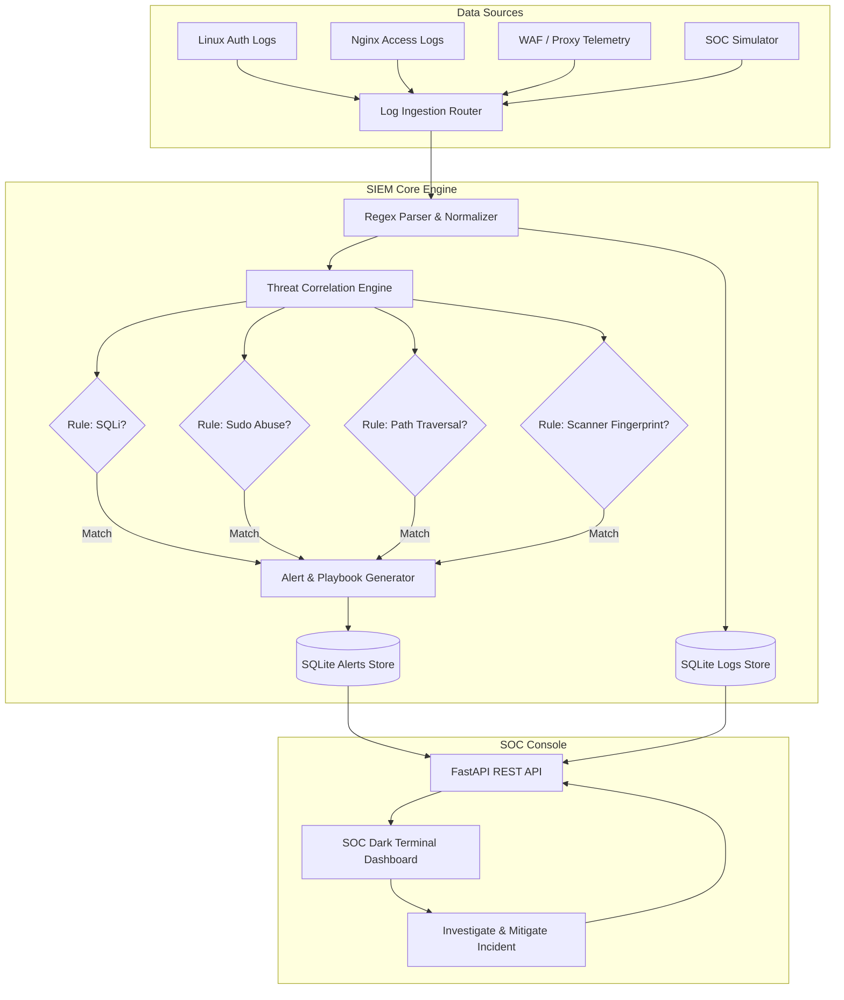

# LogSentinel — Security Information and Event Management (SIEM) & Threat Detection Platform

[](https://github.com/Soulofghost/logsentinel/actions)
[](LICENSE)
[](https://www.python.org/)
[](https://fastapi.tiangolo.com/)
[](https://attack.mitre.org/)

LogSentinel is an enterprise-grade Security Information and Event Management (SIEM) and threat correlation engine engineered for defensive security operations centers (SOC). It ingests heterogeneous syslog, authentication, and web server streams, correlates events against MITRE ATT&CK techniques, and generates actionable triage alerts alongside automated mitigation playbooks.

---

## 1. Project Introduction

LogSentinel provides high-throughput log ingestion, automated intrusion detection, and immediate mitigation workflows. Designed for SecOps engineers and incident response teams, the platform continuously correlates raw system events against rule signatures (SQL injection, relative path traversal, privilege escalation, automated vulnerability reconnaissance) and produces structured threat intelligence records.

---

## 2. Problem Statement

Modern enterprise infrastructure generates millions of log lines per hour across servers, reverse proxies, and auth gateways. Security teams face several critical bottlenecks:
- **Alert Fatigue:** Uncorrelated log streams overwhelm analysts with high-volume, low-context warnings.
- **Delayed Response Times:** Manual triage of suspicious IP addresses delays containment, allowing lateral threat propagation.
- **Lack of MITRE ATT&CK Mapping:** Disjointed tools fail to categorize attacks under a standardized adversary behavioral framework.
- **Absence of Immediate Containment Playbooks:** Analysts must formulate shell containment commands from scratch under duress.

---

## 3. Proposed Solution

LogSentinel resolves these challenges through an integrated pipeline:
1. **Multi-Source Log Ingestion:** Parses unstructured Linux syslog, auth logs, and Nginx/Apache access telemetry in real time.
2. **Defensive Rule Correlation Engine:** Evaluates ingested records against regex heuristics and attack signatures with instant MITRE ATT&CK tagging (`T1190`, `T1083`, `T1548.003`, `T1595.002`).
3. **Automated Containment Playbooks:** Produces verified mitigation commands (e.g. `iptables` drop rules, session termination) tailored to the offending source and user.
4. **Interactive SOC Dashboard:** Offers real-time incident lifecycle management (`OPEN` -> `INVESTIGATING` -> `RESOLVED`) and one-click attack scenario injection.

---

## 4. Key Features

- **Real-Time Stream Correlation:** Ingests and correlates raw logs against zero-latency rule engines.
- **MITRE ATT&CK v14.1 Mapping:** Classifies attacks into standardized adversarial tactics and techniques.
- **Automated Incident Triage:** Categorizes events by severity (`CRITICAL`, `HIGH`, `MEDIUM`, `LOW`).
- **Defensive Playbook Generation:** Automatically generates firewall isolation and process termination commands.
- **Built-in Attack Simulator:** Test SOC readiness with simulated SQLi, directory traversal, sudo abuse, and scanner payloads.
- **Zero External Dependencies:** Built on lightweight FastAPI and SQLite WAL mode with zero heavy agent requirements.

---

## 5. Architecture Diagram



---

## 6. Technology Stack

- **Backend:** Python 3.11+, FastAPI, Pydantic v2, Starlette
- **Detection Engine:** Heuristic Regex Correlator, URL Decoding & Normalization Pipeline
- **Database:** SQLite with Write-Ahead Logging (WAL) and index optimizations
- **Frontend:** Vanilla ES6+ JavaScript, CSS3 Design System with JetBrains Mono & Space Grotesk
- **DevOps:** Docker, Docker Compose, GitHub Actions CI
- **Testing:** Pytest, HTTPX TestClient

---

## 7. Folder Structure

```
logsentinel/
├── .github/
│   └── workflows/
│       └── ci.yml
├── backend/
│   ├── app/
│   │   ├── engine/
│   │   │   ├── __init__.py
│   │   │   └── detector.py
│   │   ├── routers/
│   │   │   ├── __init__.py
│   │   │   ├── alerts.py
│   │   │   └── logs.py
│   │   ├── __init__.py
│   │   ├── config.py
│   │   ├── database.py
│   │   ├── main.py
│   │   └── schemas.py
│   ├── tests/
│   │   ├── __init__.py
│   │   ├── test_api.py
│   │   └── test_detection.py
│   └── requirements.txt
├── frontend/
│   ├── app.js
│   ├── index.html
│   └── style.css
├── .env.example
├── .gitignore
├── Dockerfile
├── docker-compose.yml
├── LICENSE
└── README.md
```

---

## 8. Installation Instructions

### Prerequisites
- Python 3.11 or later
- Git

### Local Setup
```bash
# Clone the repository
git clone https://github.com/Soulofghost/logsentinel.git
cd logsentinel

# Create and activate virtual environment
python -m venv venv
source venv/bin/activate  # On Windows: .\venv\Scripts\activate

# Install dependencies
pip install -r backend/requirements.txt
```

---

## 9. Environment Configuration

Copy `.env.example` to `.env`:
```bash
cp .env.example .env
```

| Variable | Default | Description |
|---|---|---|
| `PORT` | `8000` | Application port |
| `LOGSENTINEL_DB` | `logsentinel.db` | SQLite database file location |
| `LOG_LEVEL` | `INFO` | Logging verbosity |

---

## 10. Database Setup

The database initializes automatically on first run. To manually verify or reset the schema:
```bash
python -c "from app.database import init_db; init_db()"
```

---

## 11. API Documentation

### Endpoints Overview

| Method | Endpoint | Description |
|---|---|---|
| `GET` | `/api/v1/health` | SIEM health and MITRE ATT&CK version |
| `GET` | `/api/v1/logs` | Retrieve recent ingested log stream |
| `POST` | `/api/v1/logs` | Ingest raw log entry and run threat detection |
| `GET` | `/api/v1/alerts` | List security incident alerts (supports `?status=`) |
| `PATCH` | `/api/v1/alerts/{id}/status` | Transition alert status (`INVESTIGATING`, `RESOLVED`) |
| `GET` | `/api/v1/alerts/metrics/summary` | SOC summary metrics |

---

## 12. Screenshots / Interface Walkthrough

- **Threat Telemetry Strip:** Real-time counters showing total ingested logs, critical alarms, and resolution statistics.
- **Incident Command Center:** Filterable incident cards displaying MITRE techniques, attacker IP, and one-click playbooks.
- **Log Stream Terminal:** High-contrast terminal log tail updating continuously as telemetry arrives.
- **Simulator Toolbar:** 1-click test injector for validating detection and containment workflows.

---

## 13. Testing Instructions

Execute the automated test suite covering parsing heuristics, detection rules, and REST API flows:
```bash
cd backend
pytest tests/ -v
```

Expected output:
```
tests/test_api.py::test_health_check PASSED
tests/test_api.py::test_ingest_benign_log PASSED
tests/test_api.py::test_ingest_malicious_sqli_log PASSED
tests/test_api.py::test_list_logs_and_alerts PASSED
tests/test_api.py::test_metrics_summary PASSED
tests/test_detection.py::test_parse_linux_auth_log PASSED
tests/test_detection.py::test_detect_sqli_exploit PASSED
tests/test_detection.py::test_detect_path_traversal PASSED
tests/test_detection.py::test_detect_privilege_escalation PASSED
tests/test_detection.py::test_detect_scanner_reconnaissance PASSED
```

---

## 14. Security Considerations

- **Authorization Scope:** LogSentinel is strictly intended for authorized defensive monitoring and internal telemetry correlation.
- **Sanitized Execution:** Playbook commands are presented as defensive remediation recommendations and should only be executed by authorized system administrators.
- **Database Hardening:** Parameterized queries are enforced across all database queries to prevent injection.

---

## 15. Deployment Instructions

### Docker Deployment
```bash
docker-compose up --build -d
```
Access the dashboard at `http://localhost:8000`.

---

## 16. Known Limitations

- **Stateful In-Memory Correlation Window:** Multi-stage brute force attacks currently correlate over a 15-minute sliding window per host.
- **Single-Node Ingestion:** Designed for mid-sized clusters; multi-node ingestion requires a Redis message broker buffer.

---

## 17. Future Roadmap

- [ ] Distributed Syslog UDP/TCP daemon listener.
- [ ] Sigma rule converter to automatically import community threat rules.
- [ ] Webhook alerts for Slack and PagerDuty integration.
- [ ] Automated IP reputation lookup via AbuseIPDB API.

---

## 18. License

Distributed under the MIT License. See [LICENSE](LICENSE) for details.
